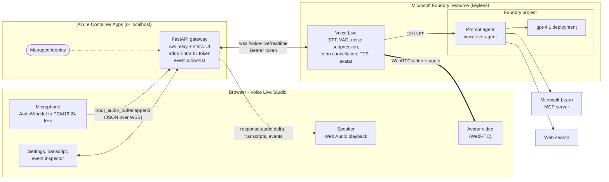
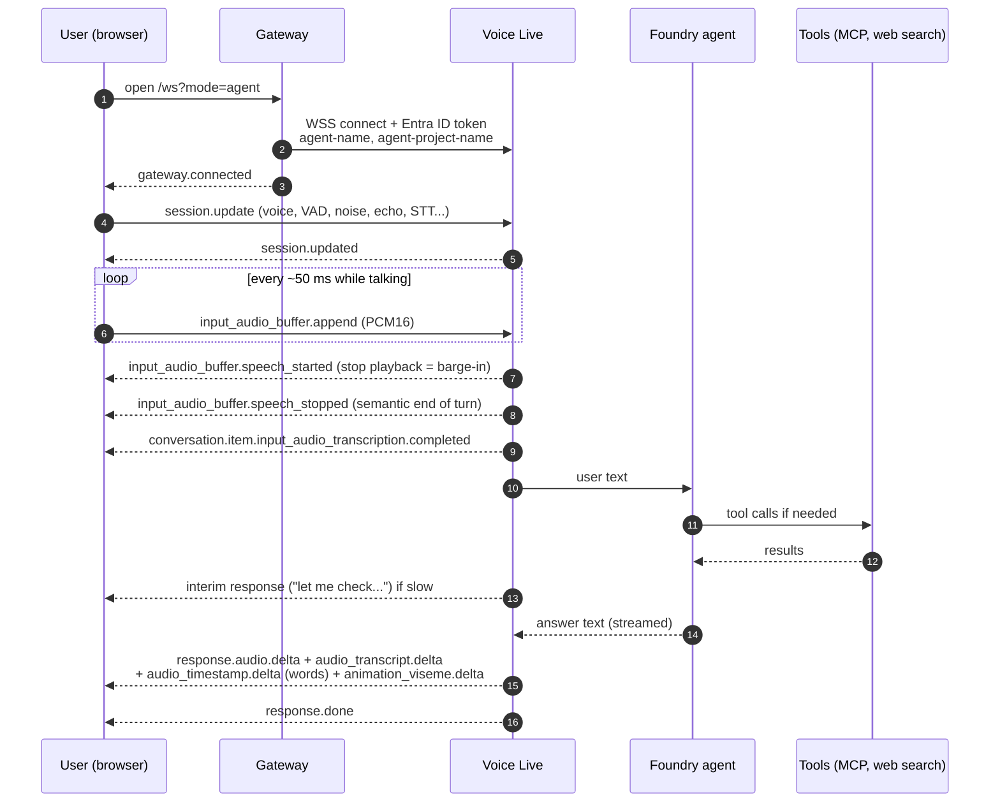

# Foundry Voice Live Agent

A complete, shareable sample that gives a **Microsoft Foundry prompt agent a real-time voice** using **Azure Speech Voice Live**, and includes a browser studio that lets you try every Voice Live feature: HD voices, semantic turn detection, barge-in, noise suppression, echo cancellation, multilingual speech recognition, phrase lists, interim responses, word timestamps, visemes, talking avatars, function calling, and MCP tools.

`azd up` deploys everything: the Foundry resource, project, model, agent, and a hosted web app.

> **New to voice AI?** Start with [How it works](#how-it-works-in-plain-language), then follow the [5-minute demo script](#5-minute-demo-script).

---

## Table of contents

1. [What you get](#what-you-get)
2. [Architecture](#architecture)
3. [How it works (in plain language)](#how-it-works-in-plain-language)
4. [Quick start (one command)](#quick-start-one-command)
5. [Use an existing Foundry project](#use-an-existing-foundry-project)
6. [Run locally](#run-locally)
7. [Sample prompts](#sample-prompts)
8. [5-minute demo script](#5-minute-demo-script)
9. [Feature guide](#feature-guide-every-setting-explained)
10. [Customise the agent](#customise-the-agent)
11. [Configuration reference](#configuration-reference)
12. [Voice Live protocol cheat sheet](#voice-live-protocol-cheat-sheet)
13. [Repository layout](#repository-layout)
14. [Security](#security)
15. [Cost and clean-up](#cost-and-clean-up)
16. [Troubleshooting](#troubleshooting)
17. [Going further](#going-further)

---

## What you get

| Component | What it is |
| --- | --- |
| **Foundry prompt agent** `voice-live-agent` | A Foundry Agent Service prompt agent ("Aria") on `gpt-4.1` with two tools: the **Microsoft Learn MCP server** (grounded answers about Microsoft products) and **web search** (live facts like weather). Its default voice settings are stored on the agent. |
| **Voice Live** | The managed Azure Speech service that turns the text agent into a real-time voice agent: speech recognition, turn detection, noise suppression, echo cancellation, neural/HD text to speech, and avatars. No audio model to deploy. |
| **Voice Live Studio** (web app) | A browser app with every Voice Live setting exposed, live transcripts, latency metrics, a lip-sync face driven by visemes, an avatar video player, and a protocol event inspector. |
| **Gateway** (FastAPI) | A small, secure WebSocket relay that adds Microsoft Entra ID auth so no keys or tokens reach the browser. |
| **Infrastructure as code** | Bicep + `azd`: Foundry resource (keyless), project, model deployment, RBAC, Azure Container Apps, Container Registry, managed identity, Log Analytics. |
| **Smoke test** | `scripts/smoke_test.py` runs a full spoken turn without a microphone and saves the reply to `reply.wav`. |

---

## Architecture



**One spoken turn, step by step:**



---

## How it works (in plain language)

* **A Foundry prompt agent is a text agent.** It has a model, instructions, and tools, and it reads and writes text.
* **Voice Live adds the voice.** It listens to the microphone stream, removes background noise and echo, works out when you have finished speaking, converts speech to text, sends that text to the agent, and speaks the reply with a natural voice (or an avatar). It also lets you interrupt the agent mid-sentence.
* **The browser never talks to Azure directly.** It streams audio to the gateway, which forwards it to Voice Live with a Microsoft Entra ID token from a managed identity (or your `az login` when running locally).
* **Two ways to connect** (pick in the UI):

| Mode | Who owns the brain | Use when |
| --- | --- | --- |
| **Foundry agent** (default) | The agent in your Foundry project: instructions, tools, knowledge, versioning, tracing. Voice Live is the speech layer around it. | You want reusable agents with tools and governance. This is what customers usually want. |
| **Direct model** | Voice Live hosts the model (`gpt-realtime`, `gpt-4.1`, `phi4-mini`, ...). You send instructions and tools in the session. | Lowest latency, native speech-to-speech models (`gpt-realtime`), or quick prototypes. Demonstrates client-side function calling. |

* **Cascaded vs speech-to-speech:** with a text model or agent, Voice Live runs *speech to text, then the model, then text to speech* (cascaded). This lets you choose any Azure voice, phrase lists, custom speech, and semantic end-of-utterance detection. With `gpt-realtime` the model hears and speaks audio natively, which is the fastest option (the sample measured about 0.4 s to first audio), but some cascaded-only settings do not apply.

---

## Quick start (one command)

### Prerequisites

* An Azure subscription where you can create resources and role assignments (Owner, or Contributor + User Access Administrator).
* [Azure Developer CLI](https://aka.ms/azd-install) (`azd`) 1.10 or later
* [Azure CLI](https://learn.microsoft.com/cli/azure/install-azure-cli) (`az`)
* Python 3.10 or later
* A browser with microphone access (Edge or Chrome recommended). A headset gives the best experience.

### Deploy

```bash
git clone https://github.com/sriaishwarya1709/foundry-voice-live.git
cd foundry-voice-live

az login                 # used by the agent-creation hook
azd auth login
azd up                   # pick a subscription and a region (default swedencentral)
```

`azd up` will:

1. Create resource group `rg-<env>` with a **Foundry resource** (keyless, `disableLocalAuth=true`), a **project**, and a **`gpt-4.1`** deployment.
2. Grant **you** and the **web app's managed identity** the `Foundry User` and `Cognitive Services User` roles.
3. Run `scripts/postprovision.*`, which writes `.env` and runs `agent/create_agent.py` to create the **`voice-live-agent`** prompt agent with Voice Live defaults in its metadata.
4. Build the container in Azure Container Registry and deploy it to **Azure Container Apps**.

When it finishes, open the `WEB_URL` it prints, click **Start session**, allow the microphone, and say hello.

> **Important:** make sure `az login` and `azd auth login` use the **same account and tenant** (check with `az account show`). The agent is created with your Azure CLI identity, and the roles are granted to the azd identity.

#### Optional `azd` settings (set before `azd up`)

```bash
azd env set AZURE_LOCATION swedencentral      # any region in the allowed list in infra/main.bicep
azd env set MODEL_NAME gpt-4.1-mini           # chat model for the agent
azd env set MODEL_VERSION 2025-04-14
azd env set MODEL_CAPACITY 50                 # thousands of tokens per minute
azd env set AGENT_NAME voice-live-agent
azd env set DEMO_ACCESS_CODE "pick-a-code"    # require a code before sessions start (recommended for shared demos)
azd env set DEPLOY_WEB_APP false              # Foundry + agent only, no hosting
```

**Regions:** Voice Live, HD voices, and avatars are all available in `swedencentral`, `westeurope`, `northeurope`, `eastus2`, `westus2`, `southcentralus`, `southeastasia`, and `centralindia`. Check the [Voice Live region support](https://learn.microsoft.com/azure/ai-services/speech-service/regions?tabs=voice-live) page for the latest list.

---

## Use an existing Foundry project

If you already have a Foundry resource and project:

1. Make sure your account has **Foundry User** (formerly *Azure AI User*) and **Cognitive Services User** on the Foundry resource.
2. Copy `.env.sample` to `.env` and fill in:

   ```ini
   AZURE_VOICELIVE_ENDPOINT=https://<resource>.services.ai.azure.com/
   FOUNDRY_PROJECT_ENDPOINT=https://<resource>.services.ai.azure.com/api/projects/<project>
   FOUNDRY_PROJECT_NAME=<project>
   MODEL_DEPLOYMENT_NAME=<your chat deployment, for example gpt-4.1>
   AGENT_NAME=voice-live-agent
   ```

3. Create the agent and run the app:

   ```bash
   python -m venv .venv
   .venv\Scripts\activate            # macOS/Linux: source .venv/bin/activate
   pip install -r requirements.txt
   az login
   python agent/create_agent.py
   uvicorn app.main:app --port 8000
   ```

You can also point the app at **any existing prompt agent**: set `AGENT_NAME` to its name. Voice Live reads the agent's instructions and tools; the UI settings control the voice side.

---

## Run locally

After `azd up` (or the manual steps above) your `.env` is ready:

```bash
.venv\Scripts\activate             # macOS/Linux: source .venv/bin/activate
uvicorn app.main:app --port 8000
```

Open <http://localhost:8000>. Microphones only work on `localhost` or HTTPS.

Headless check (no microphone needed). It sends a typed question and saves the spoken answer:

```bash
python scripts/smoke_test.py                                 # Foundry agent
python scripts/smoke_test.py --mode model --model gpt-realtime
python scripts/smoke_test.py --url wss://<your-app>.azurecontainerapps.io
```

Example output:

```text
gateway connected -> agent 'voice-live-agent' api 2026-04-10
session sess_... ready (agent=voice-live-agent, voice=en-US-Ava:DragonHDLatestNeural)
agent said: Azure Voice Live is a Microsoft technology that lets people have real-time conversations with AI ...
time to first audio: 1341 ms
audio: 10.7s saved to reply.wav
```

---

## Sample prompts

Speak these or click the chips under the transcript. Each one shows off a specific capability.

| Try saying | What it demonstrates |
| --- | --- |
| "Hi! What can you do, and what is Voice Live doing in this conversation?" | Basic loop, agent persona, HD voice |
| "Which Azure regions support Voice Live avatars?" | Agent calls the **Microsoft Learn MCP** tool for a grounded answer, with an **interim response** while it searches |
| "How do I give a Foundry agent a toolbox?" | MCP grounding on Microsoft docs |
| "What's the weather in Seattle right now?" | **Web search** tool (agent mode) or the `get_weather` **function** (model mode) |
| "What time is it in Tokyo?" (model mode) | Client-side **function calling** |
| "Tell me a long story about a dragon who learns to code." Then interrupt with "Stop, make it about a robot instead." | **Barge-in**, auto-truncation, and filler-word handling |
| "Um... I was wondering... uh... could you... explain what semantic VAD is?" | **Semantic end-of-utterance detection**: the agent waits through your pauses and "ums" |
| "¿Puedes seguir la conversación en español?" then "Et maintenant en français ?" | **Multilingual** recognition and multilingual voices (pick `azure_semantic_vad_multilingual` and a *Multilingual* voice) |
| "My project is called Contoso Foundry Voice Live." | **Phrase list** boosting of product names (edit the list in section 3) |
| Turn on music or a fan, then ask a question | **Deep noise suppression** |
| Use speakers (no headset) and talk over the agent | **Server echo cancellation**: the agent does not hear itself |
| "Give me three tips for a great customer support call." | Word-by-word **captions** from audio timestamps, **viseme** lip-sync on the face |

---

## 5-minute demo script

1. **Open the app** and the **Event inspector** (top right). Explain that the left panel maps one-to-one to the Voice Live `session.update` JSON.
2. **Start session**. The agent greets you. Point out the first events: `gateway.connected`, `session.update`, `session.updated`, and the agent name in the transcript.
3. Ask **"Which Azure regions support Voice Live avatars?"** You will hear a short interim phrase, then a grounded answer from Microsoft Learn. Show `mcp_list_tools.completed` in the inspector and the *Last latency* metric.
4. Ask for **a long story** and **interrupt it** mid-sentence. Playback stops instantly (`input_audio_buffer.speech_started`) and the agent answers the new question.
5. **Change the voice** to `en-US-Andrew:DragonHDLatestNeural` and the rate to 1.2, then click **Apply settings live**. Ask anything. The voice changes without reconnecting.
6. **Switch language**: speak Spanish or French and the agent follows.
7. **Stop session**, enable **Avatar** (section 7), and start again. The same agent now has a photorealistic talking avatar over WebRTC.
8. Finish with **Direct model mode** on `gpt-realtime` to compare latency (often under half a second) and show client-side function calling ("What time is it in Tokyo and the weather in Paris?").

---

## Feature guide: every setting explained

Each UI section maps directly to fields in the Voice Live `session.update` event. Open the **Event inspector** and click `session.update` to see the exact JSON.

### 1. Connection

| Setting | Protocol | Notes |
| --- | --- | --- |
| Mode: Foundry agent | URL `?agent-name=...&agent-project-name=...` | Requires Entra ID auth. Instructions and tools come from the agent. |
| Mode: Direct model | URL `?model=gpt-realtime` | Model allow-list is set on the server (`VOICELIVE_MODELS`). |
| Instructions, temperature | `instructions`, `temperature` | Direct model mode only (not supported with agents). |

### 2. Voice (text to speech)

| Option | Protocol | Notes |
| --- | --- | --- |
| **HD voices** (`...:DragonHDLatestNeural`) | `voice: {type: "azure-standard", name, temperature}` | Most natural and expressive; `temperature` adds variation. |
| **MAI-Voice-2-Flash** (preview) | `voice.name = "en-US-Harper:MAI-Voice-2-Flash"` | Ultra-low-latency expressive voice. |
| **Multilingual neural voices** | `voice.name = "en-US-AvaMultilingualNeural"` | Speaks many languages with one persona. |
| Any of 600+ neural voices | type the name in *Or type any voice name* | See the [voice gallery](https://speech.microsoft.com/portal/voicegallery). |
| **Custom neural voice** (your brand voice) | `voice: {type: "azure-custom", name, endpoint_id}` | Requires a trained and deployed custom voice. |
| **OpenAI voices** | `voice: {type: "openai", name: "marin"}` | `gpt-realtime` family only. |
| **Azure realtime native voices** | `voice: {type: "azure-realtime-native", name: "ava"}` | `azure-realtime` model only. |
| Speaking rate | `voice.rate` (0.5 to 1.5) | Azure voices. |

### 3. Speech recognition (speech to text)

| Option | Protocol | Notes |
| --- | --- | --- |
| `azure-speech` | `input_audio_transcription.model` | Default for agents and text models. Supports phrase lists and custom speech. |
| `mai-transcribe` (preview) | same | Microsoft AI transcription model. |
| `whisper-1`, `gpt-4o-transcribe` | same | `gpt-realtime` only. |
| Language / multi-language | `input_audio_transcription.language` (`en-US` or `en-US,es-ES,...`) | Leave empty for auto-detect. |
| **Phrase list** | `input_audio_transcription.phrase_list` | Boosts brand names and jargon. |
| **Custom speech** | `input_audio_transcription.custom_speech: {"en-US": "<endpoint id>"}` | Your fine-tuned speech model. |

### 4. Turn detection and interruptions

| Option | Protocol | Notes |
| --- | --- | --- |
| `azure_semantic_vad` | `turn_detection.type` | Detects the end of a turn from meaning, not only silence. Works with all models. |
| `azure_semantic_vad_multilingual` | same | English, Spanish, French, Italian, German, Japanese, Portuguese, Chinese, Korean, Hindi. |
| `server_vad` | same | Classic volume-based detection. |
| `semantic_vad` | same | OpenAI semantic VAD (`gpt-realtime` only). |
| `none` | `turn_detection: null` | Push-to-talk: the **Hold to talk** button sends `input_audio_buffer.commit` + `response.create`. |
| Threshold, silence, prefix padding | `threshold`, `silence_duration_ms`, `prefix_padding_ms` | Tune for noisy rooms or slow speakers. |
| **End-of-utterance model** | `end_of_utterance_detection: {model: "semantic_detection_v1_multilingual"}` | Waits through mid-sentence pauses. Cascaded pipelines only (agents and text models), not `gpt-realtime`. |
| **Ignore filler words** | `remove_filler_words` | "um", "uh", "yeah" do not interrupt the agent. |
| **Barge-in** | `interrupt_response` | Speak over the agent to interrupt it. The client also clears its playback queue on `speech_started`. |
| **Auto-truncate** | `auto_truncate` | Conversation history keeps only what the user actually heard. |

### 5. Audio enhancements

| Option | Protocol | Notes |
| --- | --- | --- |
| Deep noise suppression | `input_audio_noise_reduction: {type: "azure_deep_noise_suppression"}` | General background noise. |
| Headset mode | `azure_deep_noise_suppression_headset` | Also removes background *speakers* (call centres, open offices). |
| Personal noise suppression | `azure_personal_noise_suppression` | Keeps only the target speaker's voice. |
| **Server echo cancellation** | `input_audio_echo_cancellation: {type: "server_echo_cancellation"}` | Use laptop speakers without the agent hearing itself. |
| Browser echo cancellation | `getUserMedia({echoCancellation})` | Client-side AEC; enabled automatically when the avatar is on. |
| Input sample rate | `input_audio_sampling_rate` (16000 or 24000) | Fixed for the session. |

### 6. Conversation behaviour

| Option | Protocol | Notes |
| --- | --- | --- |
| **Proactive greeting** (generated) | `conversation.item.create` (system message) + `response.create` | The agent speaks first. |
| **Pre-generated greeting** | `response.create` with `pre_generated_assistant_message` | Fixed, deterministic opening line. |
| **Interim responses** (LLM or static) | `interim_response: {type: "llm_interim_response" or "static_interim_response", triggers: ["latency","tool"], latency_threshold_ms}` | Fills silence while the agent thinks or runs tools. |
| **Word timestamps** | `output_audio_timestamp_types: ["word"]` produces `response.audio_timestamp.delta` | Drives the live caption under the face. |
| **Visemes** | `animation: {outputs: ["viseme_id"]}` produces `response.animation_viseme.delta` | Drives the mouth of the animated face. Use for 2D/3D characters. |

### 7. Avatar

| Option | Protocol | Notes |
| --- | --- | --- |
| Video avatar | `avatar: {type: "video-avatar", character: "lisa", style: "casual-sitting", video: {...}}` | Photorealistic standard avatars. |
| Photo avatar (VASA) | `avatar: {type: "photo-avatar", model: "vasa-1", character: "anika"}` | Talking head from a single photo. |
| Custom avatar | `customized: true` | Your own trained avatar. |
| Background colour | `avatar.video.background.color` | |
| WebRTC handshake | `session.updated.avatar.ice_servers` then `session.avatar.connect {client_sdp}` then `session.avatar.connecting {server_sdp}` | Audio and video stream peer-to-peer over WebRTC. |

### 8. Tools (direct model mode)

| Tool | Where it runs |
| --- | --- |
| `get_current_time` function | In the browser. The client handles `response.function_call_arguments.done`, returns `function_call_output`, then sends `response.create`. |
| `get_weather` function | In the browser, using the free Open-Meteo API. |
| Microsoft Learn MCP server | Inside Voice Live (`tools: [{type: "mcp", server_url: ...}]`). |

In **agent mode**, tools live on the Foundry agent (`agent/create_agent.py`) and run in Foundry Agent Service, so your client stays simple.

### Live updates

**Apply settings live** sends a new `session.update` mid-conversation, so you can switch voice, rate, VAD, noise suppression, and more without reconnecting. Avatar and sample rate are fixed for a session.

---

## Customise the agent

Everything about the agent lives in `agent/`:

| File | Change it to |
| --- | --- |
| `agent/instructions.md` | Change the persona, rules, and guardrails. Keep answers short and speech-friendly. |
| `agent/voicelive_config.json` | Change the **default** voice, VAD, noise suppression, and transcription for *any* Voice Live client that connects to this agent. It is stored in agent metadata (`microsoft.voice-live.configuration`, chunked into 512-character values). |
| `agent/create_agent.py` | Add or remove tools: Azure AI Search, file search, code interpreter, OpenAPI, your own MCP servers, or a Foundry toolbox. |

Publish a new version:

```bash
python agent/create_agent.py      # creates version N+1; Voice Live uses the latest by default
```

Pin a version for production by setting `AGENT_VERSION=<n>` in `.env` (local) or as an environment variable on the container app (Azure).

To use your **own** existing agent, set `AGENT_NAME` (and the project) in `.env` or on the container app.

---

## Configuration reference

Server-side environment variables (`.env` locally, container app settings in Azure):

| Variable | Required | Description |
| --- | --- | --- |
| `AZURE_VOICELIVE_ENDPOINT` | yes | `https://<resource>.services.ai.azure.com/` |
| `FOUNDRY_PROJECT_NAME` | agent mode | Project that contains the agent |
| `AGENT_NAME` | agent mode | Agent to connect to |
| `AGENT_VERSION` | no | Pin an agent version (default: latest) |
| `FOUNDRY_PROJECT_ENDPOINT` | agent creation | Used by `agent/create_agent.py` |
| `MODEL_DEPLOYMENT_NAME` | agent creation | Chat model deployment for the agent |
| `VOICELIVE_API_VERSION` | no | Default `2026-04-10` |
| `VOICELIVE_MODELS` | no | Comma-separated allow-list for direct model mode |
| `DEMO_ACCESS_CODE` | no | If set, users must enter this code to start a session |
| `ENABLE_WEB_SEARCH` | no | `false` to create the agent without web search |
| `AZURE_CLIENT_ID` | Azure only | Client ID of the user-assigned managed identity (set by Bicep) |

---

## Voice Live protocol cheat sheet

Voice Live uses JSON events over a WebSocket, compatible with the Azure OpenAI Realtime API plus Azure extensions.

**Endpoint:** `wss://<resource>.services.ai.azure.com/voice-live/realtime?api-version=2026-04-10&agent-name=<agent>&agent-project-name=<project>` (or `&model=<model>`), with header `Authorization: Bearer <token for https://ai.azure.com/.default>`.

| Client to Voice Live | Purpose |
| --- | --- |
| `session.update` | Configure voice, VAD, STT, noise, echo, avatar, tools |
| `input_audio_buffer.append` | Stream base64 PCM16 audio |
| `input_audio_buffer.commit` / `.clear` | Manual turn control (push-to-talk) |
| `conversation.item.create` | Add a text message or a `function_call_output` |
| `response.create` / `response.cancel` | Start or stop a response |
| `session.avatar.connect` | Send the WebRTC SDP offer for the avatar |

| Voice Live to client | Purpose |
| --- | --- |
| `session.created` / `session.updated` | Session state (includes agent info and avatar ICE servers) |
| `input_audio_buffer.speech_started` / `speech_stopped` | User started or stopped talking (barge-in signal) |
| `conversation.item.input_audio_transcription.delta` / `.completed` | What the user said |
| `response.audio.delta` | Agent audio (base64 PCM16 24 kHz) |
| `response.audio_transcript.delta` / `.done` | What the agent is saying |
| `response.audio_timestamp.delta` | Word timings |
| `response.animation_viseme.delta` | Mouth shapes for lip-sync |
| `response.function_call_arguments.done` | A client function should run |
| `mcp_list_tools.*` | MCP tool discovery |
| `session.avatar.connecting` | WebRTC SDP answer for the avatar |
| `response.done`, `error` | Completion and errors |

---

## Repository layout

```text
foundry-voice-live/
├── agent/
│   ├── create_agent.py          # creates/updates the Foundry prompt agent (+ Voice Live metadata)
│   ├── instructions.md          # agent persona and rules (speech-optimised)
│   └── voicelive_config.json    # default Voice Live settings stored on the agent
├── app/
│   ├── main.py                  # FastAPI gateway: Entra ID auth, WebSocket relay, event allow-list
│   ├── Dockerfile
│   ├── requirements.txt
│   └── static/                  # Voice Live Studio (plain HTML/CSS/JS, no build step)
│       ├── index.html
│       ├── app.js               # protocol client: audio, barge-in, tools, visemes, avatar
│       ├── pcm-worklet.js       # microphone to PCM16 AudioWorklet
│       └── styles.css
├── infra/
│   ├── main.bicep               # subscription scope: resource group + outputs
│   ├── resources.bicep          # Foundry, project, model, RBAC, ACR, Container Apps
│   └── main.parameters.json
├── scripts/
│   ├── postprovision.ps1 / .sh  # azd hook: write .env, create the agent
│   └── smoke_test.py            # headless end-to-end test
├── azure.yaml                   # azd project definition
├── requirements.txt             # local dev (app + agent SDK)
└── .env.sample
```

---

## Security

* **Keyless by design.** The Foundry resource has local (key) auth disabled. The gateway uses `DefaultAzureCredential`: a user-assigned **managed identity** in Azure and your `az login` locally.
* **No secrets in the browser.** Tokens stay on the server. The browser only talks to the gateway.
* **Least privilege.** The app identity only gets `Foundry User` + `Cognitive Services User` on the Foundry resource and `AcrPull` on the registry.
* **Constrained relay.** The gateway only forwards an allow-list of client event types, chooses the agent server-side, enforces a model allow-list, and checks the WebSocket `Origin`.
* **Shared demos.** The hosted app is public by default. Set `DEMO_ACCESS_CODE` (or enable [Container Apps built-in authentication](https://learn.microsoft.com/azure/container-apps/authentication) with Microsoft Entra ID) before you share the URL widely, so others can't use your Azure quota.
* **Privacy.** Audio is processed by Voice Live and not stored by this sample. Tell users when they are talking to AI, and review Microsoft's [Responsible AI guidance](https://www.microsoft.com/ai/responsible-ai) for your scenario.

---

## Cost and clean-up

You pay for Voice Live usage (per audio minute, by model tier), the agent's model tokens, avatar minutes when enabled, and a small Container Apps footprint (one always-on replica for fast WebSocket starts). See [Azure Speech pricing](https://azure.microsoft.com/pricing/details/cognitive-services/speech-services/).

Remove everything:

```bash
azd down --purge
```

---

## Troubleshooting

| Symptom | Fix |
| --- | --- |
| `does not have permissions for .../agents/write` while creating the agent | `az login` is using a different account or tenant than `azd`. Run `az account set --subscription <id>` (same account as `azd auth login`) and then `azd hooks run postprovision`. Role assignments can also take a minute or two to propagate. |
| `Voice Live rejected the connection (HTTP 401/403)` | Your identity (or the app's managed identity) needs **Foundry User** and **Cognitive Services User** on the Foundry resource. |
| `Text-based end-of-utterance detection ... only supported on cascaded pipelines` | Turn off *End-of-utterance model* when using `gpt-realtime` (the app does this automatically). |
| `Conversation already has an active response` | You spoke or typed while a response was running. It is harmless; the app waits for `response.done` before follow-ups. |
| No microphone | Use `localhost` or HTTPS, allow mic access in the browser, and close other apps that hold the mic. You can still type. |
| The agent hears itself | Keep *Server echo cancellation* on, use a headset, or enable *Browser echo cancellation*. |
| Avatar does not appear | Use a region that supports avatars, and allow WebRTC (UDP) through your network or VPN. |
| Agent answers from memory instead of using tools | Make the instructions explicit about when to call tools (see `agent/instructions.md`), then publish a new version. |
| Old UI after a redeploy | Hard refresh (Ctrl+F5). |

---

## Going further

* **Microsoft Foundry voice agents (preview):** a newer agent kind (`kind: voice`) where one definition owns the model, voice, turn-taking and tools, with built-in telephony (Teams Phone, Twilio) and voice-pipeline tracing. See [Create a voice-based prompt agent](https://learn.microsoft.com/azure/foundry/agents/quickstarts/prompt-voice-agent) and [Compare and migrate from Voice Live](https://learn.microsoft.com/azure/foundry/agents/how-to/migrate-from-voice-live).
* **Phone calls:** [Voice Live telephony](https://learn.microsoft.com/azure/ai-services/speech-service/voice-live-telephony) with Azure Communication Services.
* **Customise input and output:** [custom speech, custom voice, lexicons](https://learn.microsoft.com/azure/ai-services/speech-service/voice-live-how-to-customize).
* **Observability:** [Voice Live telemetry and tracing](https://learn.microsoft.com/azure/ai-services/speech-service/how-to-voice-live-telemetry).
* **Docs:** [Voice Live overview](https://learn.microsoft.com/azure/ai-services/speech-service/voice-live) · [How to use Voice Live](https://learn.microsoft.com/azure/ai-services/speech-service/voice-live-how-to) · [Voice Live with Foundry Agent Service](https://learn.microsoft.com/azure/ai-services/speech-service/voice-live-agents-quickstart) · [More official samples](https://github.com/microsoft-foundry/voicelive-samples)

## License

[MIT](LICENSE)
